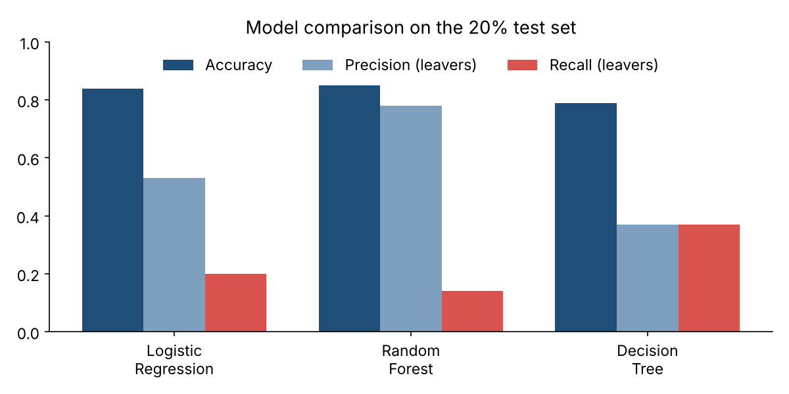
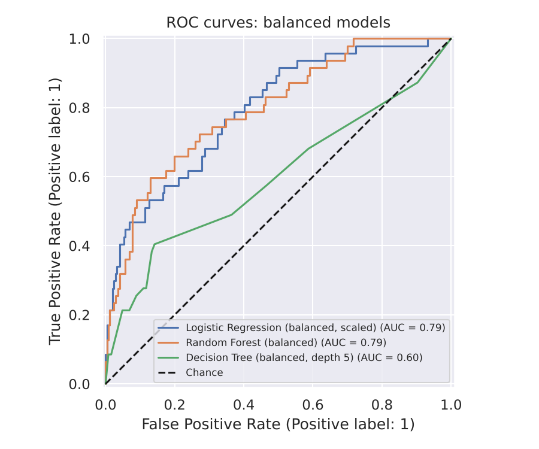

# IBM Attrition Rate: Model Comparison

Machine learning comparison for predicting employee attrition on the IBM HR Analytics dataset (1,470 employees, 35 fields). Three classifiers are trained and compared, then the best-performing family (Random Forest) is tuned with a grid search.

> Companion repo: [IBM-Employee-Attrition](https://github.com/Paulolaide25/IBM-Employee-Attrition) covers the exploratory analysis and what drives attrition.



## Approach
1. Cleaned the data and dropped constant or ID columns (`EmployeeCount`, `EmployeeNumber`, `Over18`, `StandardHours`).
2. Encoded the target (Yes/No to 1/0) and one-hot encoded the categorical fields.
3. Split 80/20 into train and test sets (294 test employees, 49 of whom left).
4. Trained Logistic Regression, Random Forest and Decision Tree models, then compared them.
5. Tuned the Random Forest with `GridSearchCV`.

## Results on the test set
| Model | Accuracy | Precision (leavers) | Recall (leavers) | F1 (leavers) |
|---|---|---|---|---|
| Logistic Regression | 0.84 | 0.53 | 0.20 | 0.29 |
| Random Forest | 0.85 | 0.78 | 0.14 | 0.24 |
| Decision Tree | 0.79 | 0.37 | 0.37 | 0.37 |

**What this shows:** Random Forest has the highest accuracy and is the most precise when it does flag a leaver, but it misses most of them. The Decision Tree catches the most leavers (recall 0.37) at the cost of overall accuracy. Only about 16% of employees left, so accuracy alone is misleading, and the right model depends on whether HR wants fewer false alarms or fewer missed leavers.

The grid search selected `n_estimators=200`, `max_depth=20`, `max_features='sqrt'`, `min_samples_split=2` and `min_samples_leaf=1`.

## Improved models: class weighting and ROC-AUC
A second section of the notebook retrains the models with a **stratified split**, **class weights** and a scaled logistic regression, and judges them on leaver recall and ROC-AUC. Always predicting "stays" would be 84.0% accurate on this test set while finding no leavers.

| Model | Accuracy | Leaver precision | Leaver recall | Leaver F1 | ROC-AUC |
|---|---|---|---|---|---|
| Logistic Regression (baseline) | 0.857 | 0.609 | 0.298 | 0.400 | 0.761 |
| Logistic Regression (balanced, scaled) | 0.755 | 0.346 | 0.596 | 0.438 | 0.793 |
| Random Forest (baseline) | 0.850 | 0.800 | 0.085 | 0.154 | 0.778 |
| Random Forest (balanced) | 0.854 | 0.625 | 0.213 | 0.317 | 0.795 |
| Decision Tree (balanced, depth 5) | 0.786 | 0.352 | 0.404 | 0.376 | 0.597 |

In 5-fold cross-validation the balanced, scaled Logistic Regression had the best ROC-AUC (0.826, against 0.805 for the balanced Random Forest and 0.789 for the baseline Logistic Regression). Class weighting roughly doubles how many leavers the logistic model finds (recall 0.30 to 0.60), but accuracy falls from 0.86 to 0.76 and more warnings are false alarms. Which trade-off is right depends on the cost of losing an employee against the cost of a wasted retention conversation.



## Next steps
Tune the decision threshold to a chosen recall target, try gradient boosting, and add a cost-based comparison.

## Tools
Python, pandas, NumPy, scikit-learn, matplotlib, seaborn.

## Repository contents
| File | Description |
|---|---|
| `IBM_ATTRITION_DATA_3_MLA.ipynb` | Notebook with the full workflow |
| `IBM Employee Attrition.xlsx` | Source dataset |

## How to run
```bash
pip install pandas numpy scikit-learn matplotlib seaborn openpyxl jupyter
jupyter notebook IBM_ATTRITION_DATA_3_MLA.ipynb
```
The notebook reads `IBM Employee Attrition.xlsx` from this folder, so it runs locally or in Colab as it is.
